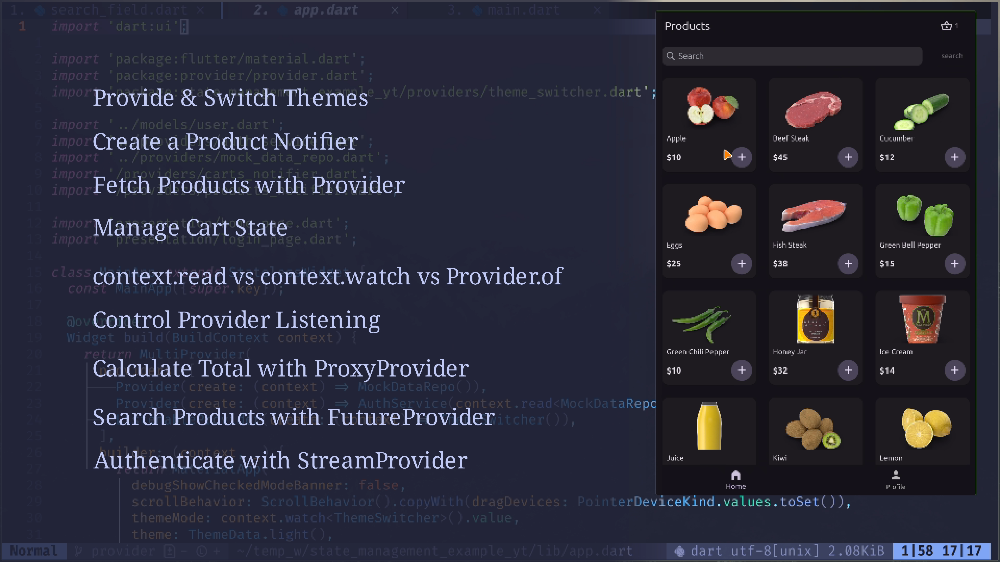
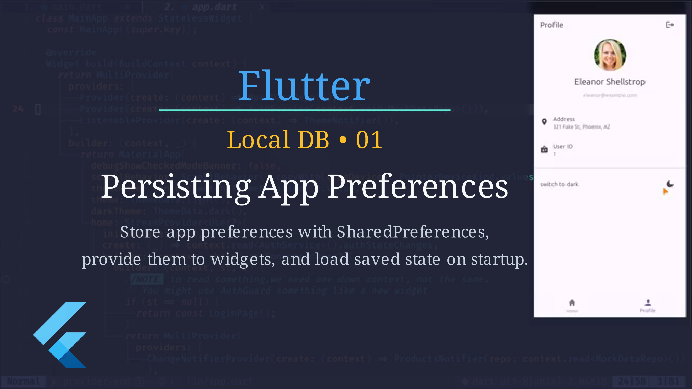
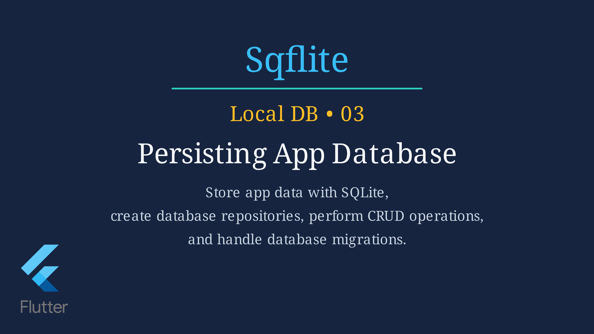

# Flutter Workshop

Not for beginners — this workshop focuses on clarifying and strengthening the essential fundamentals you need to work effectively with Flutter.

Follow along with the workshop by cloning the repository and switching to the appropriate branch.

<div align="center">

<a href="https://yeasin50.github.io/yt">
  
</a>

</div>

## Provider

Clone the repository and switch to the `provider-start` branch:

```cmd
git clone https://github.com/yeasin50/flutter_workshop
git switch provider-start
```

> If the platform-specific files are missing for your platform, run:

```bash
flutter create .
```

The final code from the video is available on the [`provider-end`](https://github.com/yeasin50/flutter_workshop/tree/provider-end) branch.

**🎥 Follow Along**

[▶️ Watch the Provider Workshop on YouTube](https://youtu.be/W5TSmnZcgcg)

[](https://youtu.be/W5TSmnZcgcg)

<br>

## shared_preferences

To star implementing start from  
 [`provider-end`](https://github.com/yeasin50/flutter_workshop/tree/provider-end) branch.

The final code of shared_preferences stays
[`local_db/01-key_value`](https://github.com/yeasin50/flutter_workshop/tree/local_db/01-key_value) branch.

```cmd
git switch local_db/01-key_value
```

**🎥 Follow Along**

[▶️ Watch the Provider Workshop on YouTube](https://youtu.be/qi6Jpf6EmB8)

[](https://youtu.be/qi6Jpf6EmB8)

<br>

## SQflite: Todo application

To star implementing start from  
 [`sqflite_start`](https://github.com/yeasin50/flutter_workshop/tree/sqflite_start) branch.

The final code of sqflite task application stays
[`sqlfite_basic_end`](https://github.com/yeasin50/flutter_workshop/tree/local_db/sqlfite_basic_end) branch.

```cmd
git switch sqflite_start
```

**🎥 Follow Along**

[▶️ Watch the Provider Workshop on YouTube](https://youtu.be/4F_m2F4fRPo)

[](https://youtu.be/4F_m2F4fRPo)

<br>
